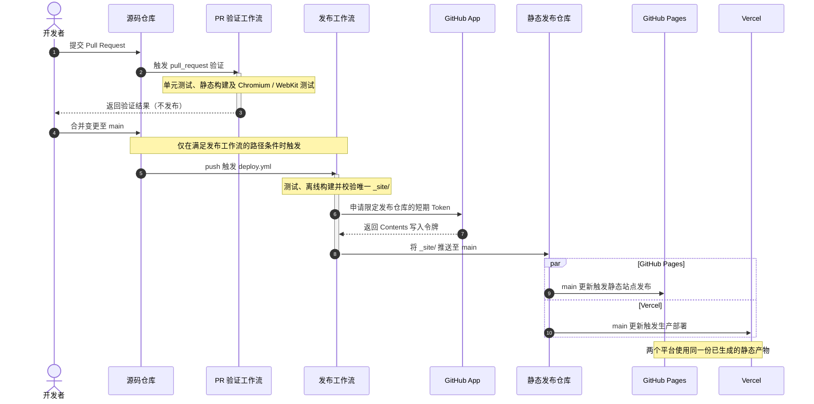
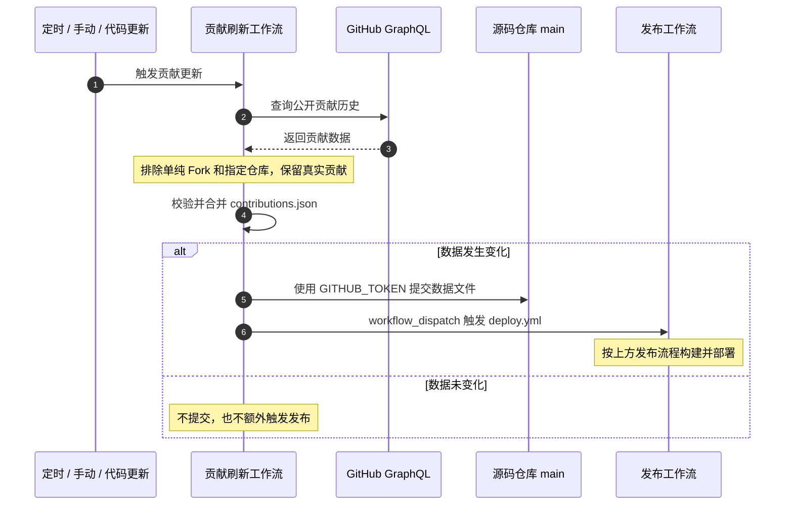

# FuTseYi-Site-Source

个人网站源码与构建仓库。网站使用原生 HTML、CSS 和 JavaScript，并通过 Python 生成静态页面。所有内容修改、构建与发布流程均在本仓库维护。

## 项目结构

```text
FuTseYi-Site-Source/
├── .github/workflows/       # 自动测试、贡献同步与跨仓库发布
├── assets/                  # 样式、脚本、字体与图片
├── posts/                   # Markdown 文章与配套资源
├── scripts/                 # 静态构建、内容处理与校验
├── tests/                   # 单元测试与浏览器回归测试
├── contributions.json       # 经过校验的版本化贡献数据
├── index.html               # 首页
├── preview.py               # 本地预览与统一构建入口
└── requirements.txt         # Python 构建依赖
```

## 技术栈

- **HTML / CSS / JavaScript** — 原生页面、样式与交互，不使用前端框架
- **Python** — Markdown 处理、静态构建与页面校验
- **Pagefind** — 静态站内搜索
- **GitHub GraphQL API** — 获取公开贡献记录，并写入版本化数据文件
- **GitHub Actions** — 自动验证、构建与跨仓库部署

## 本地开发

运行前请确保安装 Python 3.10 或更高版本。

```bash
python preview.py              # 启动本地预览
python preview.py --build-only # 构建并校验静态网站
```

运行单元测试：

```bash
python -m unittest discover -s tests -t . -p "test_*.py"
```

Windows 可使用 `py -3` 替代 `python`。预览命令会按需在本地环境安装依赖。详细说明参见 [PREVIEW.md](PREVIEW.md)。

## 自动部署

本项目通过 GitHub Actions 自动构建并发布。符合发布条件的变更进入 `main` 后，工作流会执行测试、离线构建及校验，再将完整的 `_site/` 静态产物推送至 [futseyi.github.io](https://github.com/FuTseYi/futseyi.github.io) 的 `main` 分支。

### 部署流程



### 贡献数据同步

贡献数据与网站构建相互独立。定时任务、手动触发或刷新逻辑更新时，`refresh-contributions.yml` 通过 GitHub GraphQL 获取记录，并校验、过滤和合并历史数据。



### 运行机制说明

- **唯一构建**：网站只在源码仓库生成 `_site/`，发布仓库及托管平台不重复构建。
- **自动验证**：Pull Request 运行测试和浏览器检查，不触发正式发布。
- **短期授权**：跨仓库推送使用 GitHub App 临时令牌，不依赖长期个人访问令牌。
- **离线构建**：构建使用已提交的 `contributions.json`，不在构建阶段实时请求 GitHub API。
- **自动同步**：贡献数据更新时，以仓库自带的 `GITHUB_TOKEN` 提交并显式触发同一发布工作流。
- **版本追溯**：每次发布生成 `build-info.json`，记录源码提交与 Actions 运行信息。

发布仓库中的文件由本仓库自动生成，不应直接修改；其说明文档由 [PUBLISHED_README.md](PUBLISHED_README.md) 维护。
