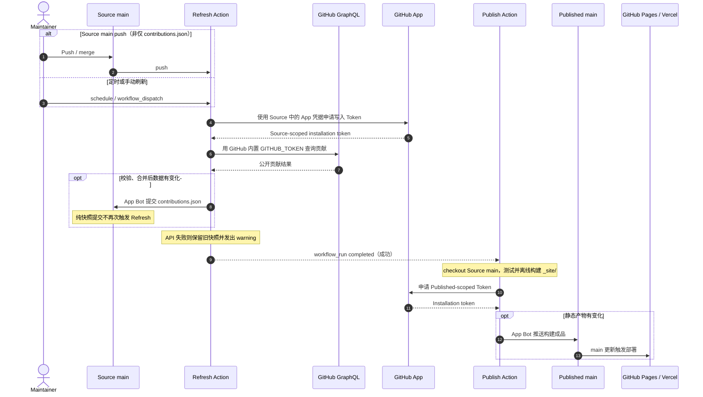

# FuTseYi-Site-Source

个人网站的唯一源码与构建仓库。基于原生 HTML、CSS、JavaScript 和 Python 生成静态网站；构建后的文件统一发布到 [FuTseYi.github.io](https://github.com/FuTseYi/FuTseYi.github.io)，供 GitHub Pages 和 Vercel 使用。

## 项目结构

```text
FuTseYi-Site-Source/
├── .github/workflows/  # 验证、贡献刷新、发布与 Profile 同步
├── assets/             # 样式、脚本、字体与图片
├── posts/              # Markdown 文章及其资源
├── scripts/            # 内容生成、索引、同步与校验
├── tests/              # 单元与浏览器回归测试
├── BLOG_INDEX.json     # 由文章元数据生成的编辑检索索引
├── contributions.json  # Git 跟踪的公开贡献数据快照
├── index.html          # 可直接维护的首页
├── preview.py          # 本地预览及唯一构建入口
└── requirements.txt    # Python 构建依赖
```

## 技术栈

- **HTML / CSS / JavaScript**：无前端构建框架的静态页面与交互
- **Python / Markdown**：文章生成、首页同步及构建验证
- **Pagefind**：构建时生成静态搜索索引
- **GitHub GraphQL**：查询公开贡献记录
- **GitHub Actions + GitHub App**：测试、刷新数据、同步 Profile 和跨仓库发布

## 本地开发

要求 Python 3.10 或更新版本。

```sh
python preview.py
python preview.py --build-only
python -m unittest discover -s tests -t . -p "test_*.py"
```

Windows 可使用 `py -3` 替代 `python`。预览、浏览器检查和环境设置见 [PREVIEW.md](PREVIEW.md)。

## 构建与发布

**Source**（本仓库）是唯一维护入口；**Published**（`FuTseYi/FuTseYi.github.io`）仅保存由 Source 产生的静态成品。GitHub Pages 与 Vercel 使用 Published 的同一份文件，不重复生成网站。发布仓库的 `README.md` 由 [PUBLISHED_README.md](PUBLISHED_README.md) 复制生成。



刷新工作流也可手动执行；网站发布工作流可独立手动运行。贡献刷新按每月 **1 日、15 日 UTC 01:17** 定时执行。普通 Source `main` Push 会先刷新，再由 `workflow_run` 触发构建；单纯 `contributions.json` 变化不会递归刷新。查询失败会保留最后一份已验证快照。构建只读取版本化数据，不在构建阶段访问 GraphQL；若静态产物没有变化，则不创建 Published 提交。Profile README 由独立的 [sync-readme.yml](.github/workflows/sync-readme.yml) 根据首页和文章变更同步到 `FuTseYi/FuTseYi`。

## 文档

- [AGENTS.md](AGENTS.md)：仓库工程原则与修改、验证边界
- [PREVIEW.md](PREVIEW.md)：开发、构建、测试和自动发布操作
- [BLOG_GUIDELINES.md](BLOG_GUIDELINES.md)：博客编辑、研究与索引规范
- [LICENSING.md](LICENSING.md)：代码、内容及第三方素材的许可说明
- [PUBLISHED_README.md](PUBLISHED_README.md)：Published 仓库 README 的唯一来源

**Every line of code should justify its existence. Define once. Reuse everywhere.**
